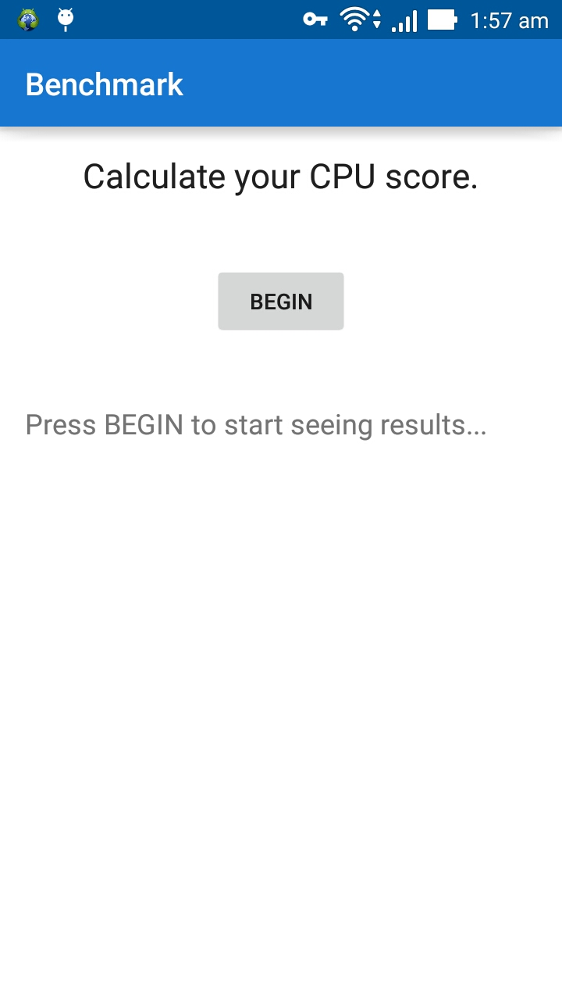
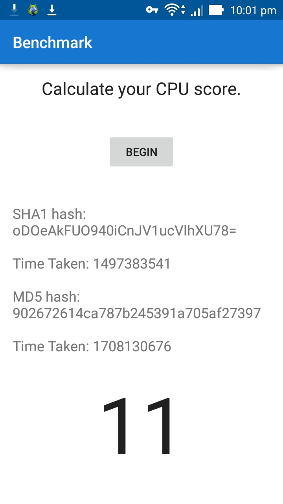
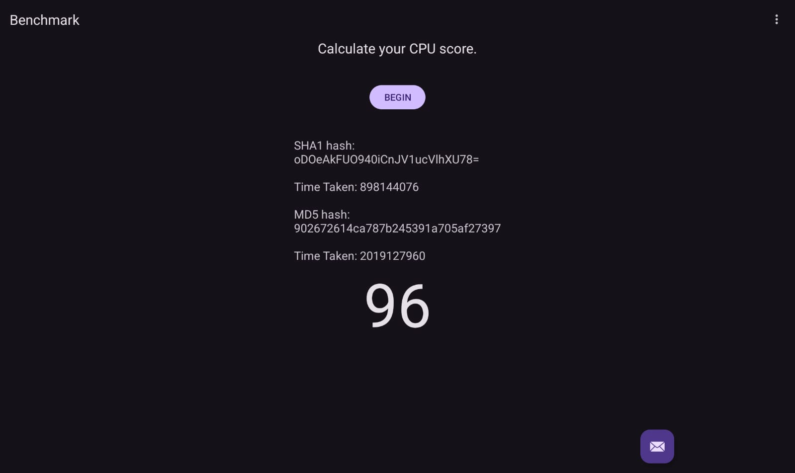

# Benchmark - Android Performance Testing App

<div align="center">
  
  
  [](https://android.com)
  [](https://android-arsenal.com/api?level=23)
  [](https://github.com/dotevolve/benchmark)
  [](LICENSE)
</div>

## Overview

Benchmark is a comprehensive Android performance testing application that provides advanced CPU benchmarking, detailed metrics analysis, and performance history tracking. Built with modern Android development practices, it offers users insights into their device's true performance capabilities.

**🌐 Website:** [benchmark.dotevolve.net](https://benchmark.dotevolve.net)  
**📱 Download:** [Google Play Store](https://play.google.com/store/apps/details?id=net.dotevolve.benchmark)

## Features

### 🚀 Core Functionality
- **CPU Performance Testing** - Comprehensive CPU benchmarks with detailed scoring
- **Cryptographic Performance** - AES, SHA-1, MD5, and RSA performance testing
- **Advanced Metrics Analysis** - In-depth performance metrics and system information
- **Performance History** - Track device performance over time with trend analysis
- **Device Statistics** - Complete hardware specifications and system details

### 📊 Technical Features
- Real-time benchmark progress tracking
- Performance visualization and charting
- Historical data persistence with SQLite
- Firebase integration for analytics and crash reporting
- Google Ads integration with consent management
- Android TV/Leanback support
- Material Design 3 UI with Jetpack Compose

## Screenshots

<div align="center">
  
  
  
</div>

## Technical Stack

### Android Development
- **Language:** Java & Kotlin
- **Min SDK:** 23 (Android 6.0 Marshmallow)
- **Target SDK:** 36
- **Build System:** Gradle with Kotlin DSL

### Key Libraries & Frameworks
- **UI Framework:** Jetpack Compose + View Binding
- **Architecture:** MVVM with Repository Pattern
- **Database:** SQLite with custom helper
- **Analytics:** Firebase (Crashlytics, Performance, Analytics)
- **Ads:** Google Mobile Ads SDK
- **Background Work:** WorkManager
- **Testing:** JUnit, Espresso, Jacoco for coverage

### Firebase Services
- Firebase Crashlytics & NDK Crashlytics
- Firebase Performance Monitoring
- Firebase Analytics
- Firebase App Check with Play Integrity
- Firebase Cloud Messaging

## Project Structure

```
app/src/main/java/net/dotevolve/benchmark/
├── ads/                    # Google Ads integration
├── core/                   # Core benchmarking engine
│   ├── BenchmarkEngine.java
│   ├── PerformanceMetrics.java
│   └── AdvancedMetrics.java
├── data/                   # Data layer
│   ├── db/                 # Database helpers
│   ├── model/              # Data models
│   └── repository/         # Repository pattern
├── services/               # Background services
├── ui/                     # User interface
│   ├── MainActivity.java
│   ├── HistoryActivity.java
│   ├── ResultDetailActivity.java
│   └── adapters/
└── work/                   # Background work managers
```

## Getting Started

### Prerequisites
- Android Studio Arctic Fox or later
- JDK 17
- Android SDK 34+
- Firebase project setup (for full functionality)

### Setup Instructions

1. **Clone the repository**
   ```bash
   git clone https://github.com/dotevolve/benchmark.git
   cd benchmark
   ```

2. **Configure Firebase**
   - Create a Firebase project
   - Add your `google-services.json` to `app/` directory
   - Configure Firebase services as needed

3. **Configure Google Ads (Optional)**
   - Set up AdMob account
   - Update ad unit IDs in `build.gradle.kts`

4. **Build the project**
   ```bash
   ./gradlew assembleDebug
   ```

5. **Run tests**
   ```bash
   ./gradlew test
   ./gradlew connectedAndroidTest
   ```

## Building

### Debug Build
```bash
./gradlew assembleDebug
```

### Release Build
```bash
./gradlew assembleRelease
```

### Generate Test Coverage Report
```bash
./gradlew jacocoTestReportDebug
```

## Architecture

The app follows modern Android architecture patterns:

- **MVVM Architecture** - Clear separation of concerns
- **Repository Pattern** - Centralized data access
- **Dependency Injection** - Modular and testable code
- **Single Activity Architecture** - Navigation with fragments
- **Reactive Programming** - LiveData and observables

## Performance Testing

The benchmark engine performs several types of performance tests:

1. **CPU Intensive Operations** - Mathematical computations and algorithms
2. **Cryptographic Operations** - AES encryption, SHA hashing, MD5
3. **Memory Operations** - Memory allocation and access patterns
4. **I/O Operations** - File system and database operations

## Benchmark Engine Versioning

Starting with engine **v2.0.0**, every benchmark run is tagged with a semantic version so historical scores can be compared safely:

- **MAJOR** — Breaking changes to the suite (new core tests, scoring overhauls). Only compare scores that share the same major number.
- **MINOR** — Additive tweaks (e.g., extra workloads) that still allow comparison within the major line.
- **PATCH** — Bug fixes or optimizations that do not alter scoring math.

The active engine version is surfaced in every result card, detail view, local database row, and Firestore record, ensuring apples-to-apples comparisons across devices.

## Contributing

We welcome contributions! Please see our [Contributing Guidelines](CONTRIBUTING.md) for details.

### Development Workflow
1. Fork the repository
2. Create a feature branch (`git checkout -b feature/amazing-feature`)
3. Commit your changes (`git commit -m 'Add amazing feature'`)
4. Push to the branch (`git push origin feature/amazing-feature`)
5. Open a Pull Request

### Code Style
- Follow Android Kotlin/Java style guidelines
- Use meaningful variable and method names
- Add appropriate comments and documentation
- Ensure all tests pass before submitting

## Testing

### Unit Tests
```bash
./gradlew testDebugUnitTest
```

### Instrumented Tests
```bash
./gradlew connectedDebugAndroidTest
```

### Code Coverage
The project uses Jacoco for code coverage reporting. Generate reports with:
```bash
./gradlew jacocoTestReportDebug
```

## Deployment

### Play Store Release
1. Update version in `build.gradle.kts`
2. Generate signed APK/AAB
3. Upload to Google Play Console
4. Update release notes

### Website & Analytics Dashboard
The companion website and live analytics dashboard are deployed at [benchmark.dotevolve.net](https://benchmark.dotevolve.net) from the repository [`DotEvolve/benchmark.dotevolve.net`](https://github.com/DotEvolve/benchmark.dotevolve.net).

## Privacy & Security

- **Privacy-First Design** - Minimal data collection
- **Local Data Storage** - Performance data stored locally
- **Transparent Privacy Policy** - Clear data usage disclosure
- **Security Best Practices** - Secure coding and data handling

See our [Privacy Policy](https://benchmark.dotevolve.net/privacy-policy.html) for details.

## License

This project is licensed under the MIT License - see the [LICENSE](LICENSE) file for details.

## Support

- **Email:** info@dotevolve.co.in
- **Privacy:** privacy@dotevolve.net
- **Website:** [benchmark.dotevolve.net](https://benchmark.dotevolve.net)

## Acknowledgments

- Android development community
- Firebase team for excellent tools
- Material Design team for design guidelines
- Open source contributors

---

<div align="center">
  <p>Made with ❤️ by <a href="https://dotevolve.net">DotEvolve</a></p>
  <p>© 2025 DotEvolve. All rights reserved.</p>
</div>
